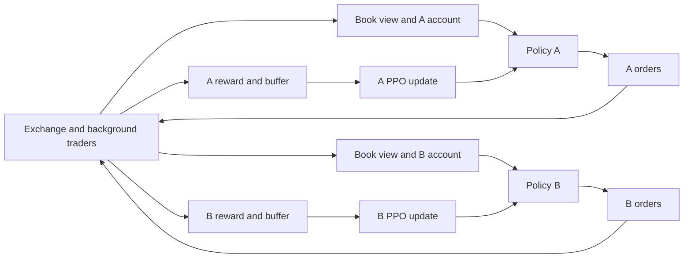
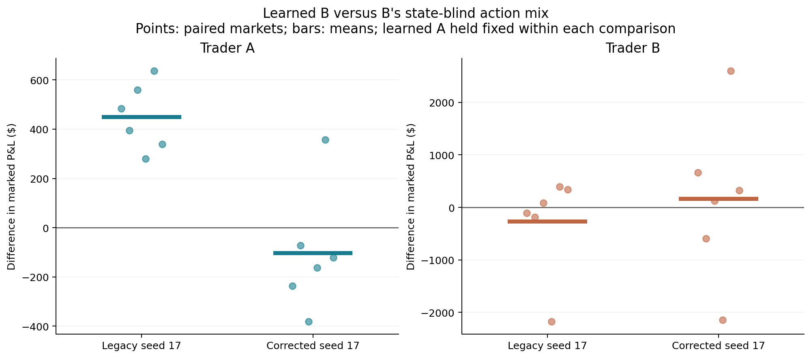
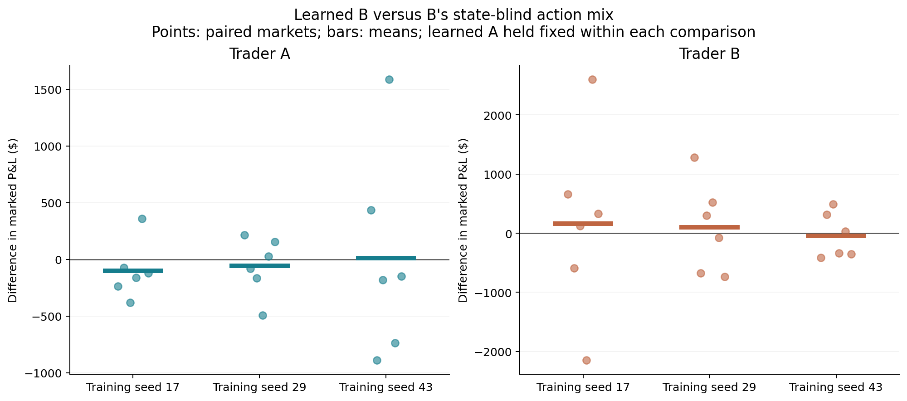
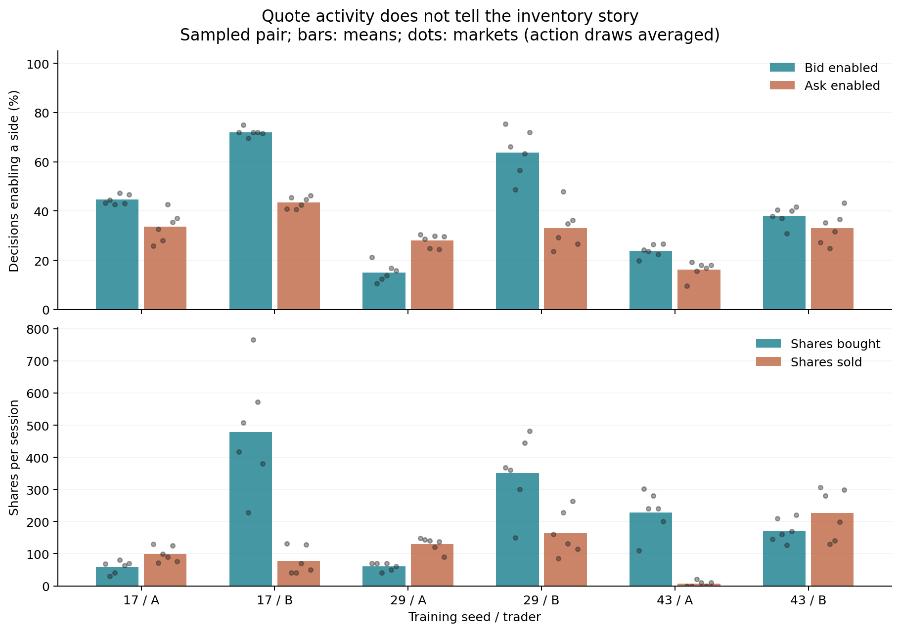
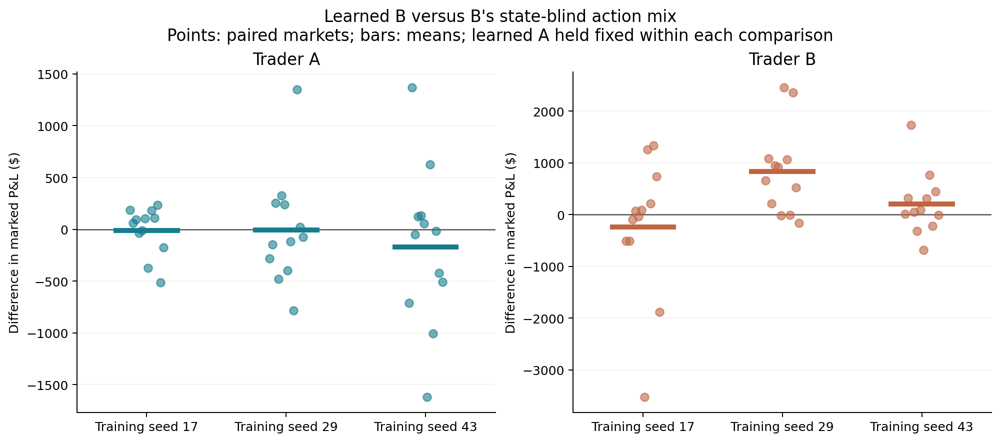
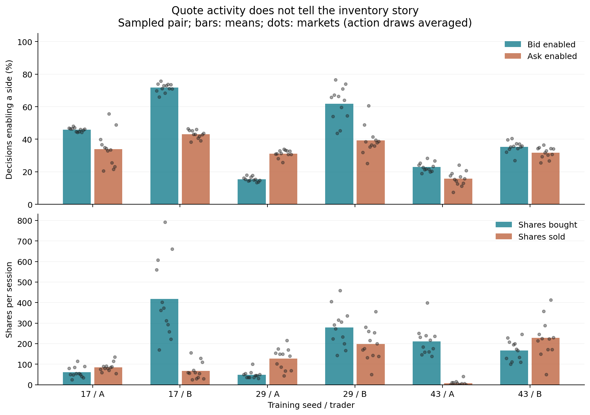

# Two learning traders in one simulated order book

**Completed research stage, 26 September 2026.** Three independent training
pairs, their exploratory controls, and the predeclared held-out comparison are
complete. One B policy had lower marked losses when it could use current state;
we have not established that it recognized or exploited the other learner.
Different policies also built very different inventories despite similar quote
rates. This report explains those findings, the implementation corrections that
changed the interpretation, and what remains to test. These are simulated
marked-account outcomes, not demonstrated real-market profitability.

## The question and the market

Can two independently learning traders develop useful behavior while they share an order book? We are interested in what each trader does, whether its decisions depend on the market state, and whether changing one trader changes the other's outcome. A response to a rival, mutual benefit, persistent inactivity, or no identifiable interaction would all be informative. We did not assign either trader a goal of exploiting the other.

A market maker offers to buy at a **bid** and sell at an **ask**. If both orders fill at favorable prices, the difference can be income. The catch is that a fill is chosen by someone else. A buy order may execute just before the price falls. The maker also keeps **inventory** until a later sale; its value moves with the market even without another execution. A useful policy must decide when to quote, how far from the current price, and how much risk to hold. A positive account value at the end is only one part of that story.

The exchange here is ABIDES, an event-driven simulator. Its background includes 2,000 noise traders, 50 value traders, 10 momentum traders, and two programmed adaptive market makers. We add two learning traders, A and B, with separate accounts. They trade the synthetic symbol `ABM` in ten-minute sessions. These are synthetic market paths, not historical exchange replay. The background participants already generate substantial flow and liquidity, so the two learners may have only a modest influence on the book. That is an empirical limitation to measure, rather than an assumption that their competition must be strong.

At each roughly one-second decision, each learner receives the top ten bid and ask levels, its own cash and inventory, the spread, time remaining, and order-flow imbalance features. The latter summarize changes in the best queues; they are not the hidden fundamental value or a full trade history. The current experiment lets each trader independently turn its bid and ask on or off and set each quote 1–16 ticks from a rounded midpoint. Each open side quotes ten shares. The quote size is deliberately fixed, so this experiment cannot show learned sizing. Outstanding orders are cancelled and replaced at each decision, losing queue priority. The market continues to process other messages between the learners' decisions.

The learning algorithm is proximal policy optimization (PPO). A neural network produces a distribution over actions; training samples from it and uses the resulting rewards to update its parameters. The reward is change in cash plus inventory valued at the current midpoint, less a small inventory penalty (`1e-4` cents per share of absolute inventory per step), with a penalty at a 1,000-share inventory-limit breach. The hard limit is the main inventory guard: holding 1,000 shares for all 600 one-second steps would incur just 60 cents from that soft penalty. PPO discounts future reward by `0.99` per step, giving roughly a 100-second discount scale, and its reward path is normalized and clipped for training. Its objective is therefore not simply undiscounted final marked P&L, much less a calibrated objective for inventory-aware profitability. There are no modeled transaction fees or forced sales at the close.

There is an important distinction between generations of the project. The older multi-agent setup used **one shared PPO network** for several accounts, with trader identity as an input. Different accounts could then take different actions, but they were not independently optimizing different sets of weights. The later sequential pilot and current concurrent experiment have **separate PPO networks, optimizers, value estimates, reward statistics, and checkpoints** for A and B. Each receives its own reward; neither receives a bonus for helping or hurting the other.

## Why the first pilot was not an interaction result

The sequential pilot established that separate policies and accounting worked. First A learned against a scripted two-sided trader. Then A's network was frozen while B learned against it. A frozen policy can still react to new observations, but its weights cannot change in response to B's subsequent training. This design therefore cannot establish mutual learning. It was a useful software and behavior pilot, with one training seed per role and three held-out markets.

A became much more active against the scripted opponent: its fraction of decisions with a quote rose from 5.0% to 87.4%. B illustrated a subtler problem. Its trained **deterministic mean** action placed no quotes in the three-market evaluation. But its Gaussian action distribution still had substantial variance: when sampled during new market rollouts, B quoted on 55.6% of decisions and received fills. The same checkpoint can thus appear inactive or active depending on how its distribution is used. Sampling is the primary concurrent evaluation mode because training samples actions; deterministic means remain an explicit diagnostic. Neither mode alone proves an economically sound decision to withdraw.

In the first sampled-B diagnostic, A's mean marked result improved, which suggested that B's presence might matter. That did not identify a learned response. A could have benefited from the mere presence of extra orders, different random market paths, or inventory-price moves. No direct A–B executions were seen in that original pilot. Direct execution is not necessary for indirect influence through the book, but its absence limits a story of one learner trading directly against the other.

We therefore evaluated the frozen sequential checkpoints on six **new exploratory market seeds**. B either sampled its trained policy, drew complete actions from B's calibration-market action pool without observing the current state, or submitted nothing. A used the same deterministic checkpoint throughout. The state-blind pool preserves the calibration distribution of whole gate/offset/size actions, including correlations among those choices. It breaks their link to the current book, inventory, and time; it cannot preserve the exact realized quote timing, fills, or market path.

| B condition | A mean marked P&L | B mean marked P&L | B decisions with a quote |
|---|---:|---:|---:|
| Learned, sampled | -$1,789.98 | -$832.27 | 59.37% |
| State-blind action pool | -$1,947.09 | -$812.51 | 59.11% |
| Inactive | -$1,017.76 | $0 | 0% |

These are six-market means for **one** trained pair and one action seed per market, not estimates over independently trained pairs. B's learned actions improved its own marked result over the state-blind replacement in only two of six markets. The paired mean difference was -$19.76, with a wide descriptive bootstrap interval of about -$499 to +$501. A did better with learned B than with the state-blind B in only two of six markets. The earlier favorable three-market average was not stable under this control. This does not show that the policies are equivalent; it means these observations do not establish a benefit from B's state-dependent choices.

The episodes also differ in duration. Three of the 18 joint evaluations hit A's inventory limit shortly before the normal 599-decision end; the others finished normally. A comparison at a common decision horizon did not change the broad conclusion, but it could not make counterfactual market paths identical. Gross executions reconcile exactly to the saved cash and inventory changes for all 36 agent trajectories. Across these 18 markets there were three direct A–B matches, all on market seed 30001. Such rare matches do not demonstrate targeting or cooperation.

## Concurrent learning: what changed

The learning loop is roughly this programmer's view:

```python
for rollout in training:
    for decision in range(256):
        action_a = sample(policy_a(observation_a))
        action_b = sample(policy_b(observation_b))
        next_observations, rewards, ended = market.step(action_a, action_b)
        buffer_a.store(observation_a, action_a, rewards.a)
        buffer_b.store(observation_b, action_b, rewards.b)
        # Advance observations; reset a finished market session as needed.
    targets_a, targets_b = estimate_returns_with_each_traders_critic()
    ppo_update(policy_a, buffer_a, targets_a)
    ppo_update(policy_b, buffer_b, targets_b)
```

This is explanatory pseudocode, not an alternative implementation. The actual collector also saves the sampled actions' probabilities and value estimates, handles episode boundaries, and normalizes each trader's rewards separately. Both buffers and return targets are finalized before either update. A critic is a network estimating future discounted reward from a state; it helps PPO judge an action relative to what the model expected. PPO updates from sampled outcomes rather than differentiating through the order book. The networks are feed-forward, not language models: they have no messaging channel, explicit opponent model, or hidden view of the other trader's account. Each sees the common market and its own state. A learned response to aggregate order flow need not be a response specifically to its fellow learner.



The main design lets A and B experience **the same market rollouts while both learn**. Each samples its own actions and stores its own observations and rewards. After every 256 joint market steps, each PPO model updates its own weights; neither updates inside that rollout. Both carry their new policies into subsequent sessions, so the other learner can be a moving part of the training environment. This is concurrent independent learning across sessions, not online weight changes during a held-out evaluation. Paired checkpoints are saved at initialization and several training stages. Evaluation freezes both networks.

The planned comparisons ask progressively narrower questions: trained sampled pair; deterministic mean pair; initial pair; trained A against initial B; trained A against inactive B; and trained A against a state-blind action-pool B. The initial policy is a reference for learning, not a participation-matched control. The inactive control removes B's submitted flow. The action-pool control asks whether B's connection to current observations matters beyond its mix of actions. Private random streams per role prevent replacing B from silently shifting A's action draws. Markets 20001–20004 calibrate the action pool; 30001–30006 are exploratory evaluations. The 40001–40012 market set was reserved for the predeclared confirmation comparison reported separately below.

The first concurrent training pairs used seeds 17, 29, and 43, with 32,768 joint steps per pair. Their checkpoints have separate changed weight hashes and completed training manifests. Only seed 17 has the full six-condition exploratory evaluation discussed below; completed training for seeds 29 and 43 is **not** a replication of its evaluation finding. A same-observation diagnostic across seed-17 checkpoints shows A's mean bid-gate probability falling from .500 to .319 and B's mean ask-gate probability falling from .500 to .169. This verifies learned network changes on those saved observations. It does not tell us whether either change improved market outcomes or responded to the other learner.

The **legacy** seed-17 exploratory evaluation completed 36 joint markets across the six conditions, plus four calibration markets. All evaluation episodes reached the normal end, and only three direct pair matches occurred. With both trained policies sampled, mean marked P&L was **A -$307.64, B -$406.77**. With sampled A and state-blind B, it was **A -$756.21, B -$133.56**. A's learned-B minus state-blind-B difference was positive on all six exploratory market seeds, averaging +$448.57. This is an intriguing candidate effect, conditional on one trained pair and this small market set. B did not show a clear benefit of its own. The evidence does not distinguish strategic accommodation from altered background flow, quote timing, and inventory exposure. The absence of many direct matches makes those indirect channels particularly important to investigate.

## What the profit numbers actually measure

Starting cash is $100,000 per learner, but it is not a cash-only trading budget here. The order-submission path uses ABIDES' default `ignore_risk=True`, so its order-level cash/capital check is bypassed; the environment's absolute-share limit still applies. Short positions and negative cash are possible without a modeled financing charge or realistic margin process. In the legacy concurrent evaluation, 48 of 72 agent trajectories at some point held a position whose absolute marked value exceeded starting cash, and 34 had negative cash. The largest position was about 4.71 times starting cash. These observations are not investor returns on a fully specified capital requirement. Changing this assumption would be a separate experiment, not a retrospective correction to the saved cash accounting.

The reported P&L is **marked account equity**: cash plus remaining shares valued at the observed midpoint, minus the starting equity. A trader can show a gain while carrying an unsold position whose eventual sale would move the price or incur costs. Equally, a large marked loss can occur from holding inventory through a price move even if the individual executions looked favorable at the time.

For each recorded step, the accounting splits the equity change into (1) inventory already held times the change in recorded midpoint and (2) cash change plus inventory change valued at that step's ending midpoint. These components add exactly to marked P&L. In the sequential controls with learned sampled B, the average A loss split into **-$1,763.36 from inventory marking** and **-$26.61 from the second component**; for B it was **-$819.62** and **-$12.65**. Inventory exposure therefore dominated those mean losses. The second term is an execution-relative-to-recorded-mid component, not pure spread capture: messages, fills, and snapshots have timing differences within a step. Calling either term “adverse selection” would require more evidence about information at execution and subsequent price movement. This accounting is descriptive, not causal.

Three other boundaries matter. First, same market seed does not mean the market path is held fixed: changing B changes book events and later orders. Second, one trained pair evaluated many times does not give independent **training** replications; market steps are not statistical samples of policy discovery. Third, the two experimental traders operate inside a much larger programmed population. Their outcomes can covary even if they rarely meet directly. We need a repeatable intervention and behavior evidence before assigning a mechanism to the positive seed-17 legacy contrast.

## The finite-horizon correction changed the candidate interaction

A later method audit found that the concurrent trainer had inherited an **external-timeout value bootstrap** at normal exchange close. A bootstrap means adding the model's estimated value of future rewards to a training target. That is appropriate when a rollout is cut short while the task continues. Here the ten-minute close is part of the task: remaining time is observed, and no post-close reward exists. The intended finite-session target has **zero continuation value at close**. Batch boundaries within an open session still need the ordinary bootstrap. The old choice affected training targets; it did not add a cash charge to the recorded evaluation accounts.

The original concurrent seed-17/29/43 runs deliberately used the old behavior for pilot comparability. Their observed orders, fills, and marked P&L remain valid descriptions of those **legacy policies**, but they cannot confirm a conclusion about policies optimized for the corrected finite-session objective. The correction now marks exchange close explicitly and uses zero close continuation by default; an explicit legacy flag reproduces the earlier target. A controlled corrected seed-17 run starts from the same initial model hashes and environment configuration as legacy seed 17, changing this training-target choice. Implementation tests and a short legacy replay passed, but those checks cannot predict the corrected policy's market behavior.

The corrected seed 17 completed 32,768 shared steps in 14.2 minutes, followed by all six exploratory conditions on six markets. Its initial network tensors, environment configuration, and training market-seed stream match legacy seed 17. All 12 initial-pair evaluation trajectories also match exactly, including observations, actions, fills, and accounts. Thus the unchanged baseline reproduces, while the changed learning target produces different trained behavior. Both evaluations' 144 agent trajectories reconcile to gross executions and the equity decomposition. Corrected evaluations had no risk stops and six direct A–B matches across 36 joint markets.

| Corrected seed 17 condition | A mean marked P&L | B mean marked P&L | A / B quote decisions |
|---|---:|---:|---:|
| Both learned, sampled | -$11.20 | -$874.81 | 64.27% / 83.03% |
| State-blind B | +$91.59 | -$1,038.45 | 66.19% / 83.75% |
| Inactive B | -$97.09 | $0 | 64.25% / 0% |
| Both initial, sampled | -$94.35 | -$223.42 | 75.82% / 76.29% |

The earlier candidate did not survive this retraining. A's learned-B minus state-blind-B difference is now **-$102.79**, positive in only **one of six markets**, compared with legacy +$448.57 in six of six. Its descriptive six-market bootstrap interval is about -$262 to +$97. B's corresponding mean difference is +$163.64, positive in four of six, with a much wider interval of about -$975 to +$1,311. Neither establishes a benefit from state-dependent B in this corrected pair. This is not evidence that the two B policies are equivalent or that interaction is impossible.

The behavior changed as well as the averages. Under sampled-pair evaluation, A's average two-sided offset sum widened from 13.08 to 23.59 cents, fills fell from 58.33 to 17.83 per session, and mean absolute inventory fell from 79.00 to 29.11 shares. B became more active and ended with an average long position of 401.83 shares, versus 99.17 before correction. Of B's corrected mean marked loss of $874.81, $859.08 belongs to the inventory-marking component. These are descriptions of this trained pair, not evidence that A learned a deliberate risk-management strategy or that B was exploited. Changing the close target changes both learned policies, so this comparison cannot isolate an opponent-response mechanism.



Each dot is one exploratory market's learned-B minus state-blind-B difference; the short bars are means. Positive means better with learned B, not necessarily profitable. The two panels have different vertical scales. A is held fixed within each replacement comparison, but both policies changed between legacy and corrected training. The [full six-condition figure](assets/concurrent_seed17_horizon_comparison.png) also shows absolute P&L and participation. The exact initial-pair reproduction is a check on the comparison, not an additional independent replication.

## What the corrected replications revealed

All three corrected pairs completed the same training budget and six-condition evaluation. The 216 evaluation trajectories reconcile, and none of the 108 joint evaluations hit the inventory limit. There were eight direct A–B matches across all conditions, but **none in the 18 sampled learned-pair episodes**. That limits a story of direct trading against a rival; it does not rule out indirect influence through the book.

| Training seed | A: learned B minus state-blind B | B: learned B minus state-blind B | A / B sampled quote decisions |
|---|---:|---:|---:|
| 17 | -$102.79; positive 1/6 markets | +$163.64; positive 4/6 | 64.27% / 83.03% |
| 29 | -$58.07; positive 3/6 | +$103.57; positive 3/6 | 37.23% / 77.99% |
| 43 | +$10.95; positive 2/6 | -$45.36; positive 3/6 | 33.92% / 59.07% |

Every pair-specific descriptive P&L interval includes zero. These results do not establish a consistent benefit from B's current-state-dependent actions. They also do not establish equivalence: uncertainty is substantial, and there are only three independently trained pairs. The positive A average for seed 43, for example, sits alongside a negative median and only two positive markets.



The more tangible behavioral finding is that **low activity is not the same as low inventory exposure**. Seed 43's A quoted on only about a third of decisions, yet averaged 228.67 shares bought and just 6.67 sold per session, ending long 222 shares. When it enabled a side, its requested bid offset averaged 7.70 cents while its ask offset averaged 15.10 cents; it also enabled asks less often than bids. It was accumulating a position rather than completing many buy/sell round trips. Its mean marked P&L was -$662.20, of which -$648.58 was the inventory-marking component.

Contrast seed 29's A: it had a similar overall quote rate, but averaged 60 shares bought and 130 sold, ending short 70 shares, with mean marked P&L +$37.95. Positive inventory is a long position, which benefits when the price rises; negative inventory is a short position, which benefits when it falls. These examples show why counting quotes or naming a neural network a market maker does not explain its economic behavior. The quote and flow summaries describe how positions arose; they do not prove an intentional directional forecast or isolate a particular quote parameter's causal contribution. The recorded buy-minus-sell totals do reconcile exactly to inventory changes.



The top panel shows how often each side is enabled; the bottom shows shares
actually bought and sold. Bars average markets and dots retain the individual
market outcomes. A quote is an offer, not a completed trade. In particular,
seed 43's A sometimes offered to sell but sold very few shares. The gap between
buy and sell totals is its ending inventory, since each session starts flat.

The final bounded check froze all three trained pairs and tested only the learned-B versus state-blind-B contrast on the reserved 12 markets, with two action draws per market. Its design was recorded before launch in the protocol. The primary outcome was B's marked P&L difference; A's outcome and quote/inventory behavior remained visible. This checked the original intervention on new markets and sensitivity to action sampling, without selecting a favorable checkpoint or launching another training sweep. All three batches are complete.

## What the held-out comparison adds

The 144 joint evaluations cover twelve new market seeds, two action draws,
and two conditions for each of three trained pairs. All 288 agent trajectories
reconcile to gross executions and the equity decomposition. Checkpoint hashes,
environment settings and regenerated calibration pools match the exploratory
runs. No episode hit the inventory limit, so the common-horizon sensitivity is
identical to the full-session comparison. There were seven direct A–B matches:
one with both learned policies and six with state-blind B, counted once per
joint episode. The learned seed 29 pair had none.

The table reports learned B minus state-blind B. Each market first averages
its two action draws. Brackets are descriptive 95% bootstrap intervals over
those twelve markets, conditional on the trained pair; they do not measure
uncertainty over all possible training runs. No multiple-comparison correction
is applied. There are still **three training replications**, not 144.

| Training seed | B P&L difference (primary) | B positive markets | A P&L difference (secondary) |
|---|---:|---:|---:|
| 17 | -$236.22 [-$1,026, +$406] | 6/12 | -$11.98 [-$146, +$101] |
| 29 | +$838.70 [+$411, +$1,332] | 9/12 | -$6.67 [-$268, +$306] |
| 43 | +$210.50 [-$93, +$575] | 8/12 | -$169.12 [-$582, +$265] |



Dots are market-level paired differences and bars are means. The panels use
different vertical scales. A's policy weights stay fixed within each
replacement comparison, but its observations, actions and realized market path
can change when B changes. [Absolute results and participation](assets/concurrent_finite_confirmation.png)
are also available.

The new markets change the interpretation: there is a **pair-specific benefit
for B in training seed 29**. Its learned policy averaged -$353.19 marked P&L,
compared with -$1,191.89 for its state-blind replacement. The paired difference
is +$838.70, positive in nine of twelve markets after averaging the two action
draws per market. Its descriptive market-bootstrap interval is +$411 to +$1,332.
Separately, action draws 0 and 1 give +$638.38 and +$1,039.02, each positive in
ten of twelve markets. A's difference is -$6.67, with an interval spanning
roughly -$268 to +$306. This is a benefit relative to the replacement, not a
profitable strategy or evidence that B made money at A's expense.

B's learned behavior in this pair bought fewer shares than the replacement
(279.21 versus 444.54 per session), also sold fewer (197.96 versus 252.62),
and ended with a smaller mean long position (81.25 versus 191.92 shares).
Mean absolute inventory was 95.41 versus 130.16 shares. Of the $838.70 P&L
difference, about $832.40 is the difference in inventory marking. This
connects the result to different exposure paths, while leaving their cause
unresolved. The intervention removes responses to B's own inventory, time,
and the broader market as well as any response to A; it cannot isolate rival
adaptation.

The other pairs limit the scope of that finding. Seed 17's B mean is negative
with a wide interval, while seed 43's positive mean also has an interval
including zero. This does not establish a universal benefit or equivalence.
B's per-action-draw mean differences are -$288.61 / -$183.84 for seed 17,
+$638.38 / +$1,039.02 for seed 29, and +$296.76 / +$124.24 for seed 43.
The full per-market and per-draw contrasts are retained in the
[analysis JSON](assets/concurrent_finite_confirmation.json), with no cases
removed because of their sign.

The directional-inventory finding also persists. Seed 43's A quoted on 32.80%
of decisions but bought 211.58 shares and sold only 7.71 per session, ending
long 203.88 shares on average. This was not peculiar to the six exploratory
markets. The table describes the sampled learned pairs on the confirmation
markets; offsets are conditional on enabling that side, before any extra
half-tick outward rounding.

| Pair / trader | Any quote (%) | Bid / ask offset (cents) | Bought / sold shares | Ending inventory |
|---|---:|---:|---:|---:|
| 17 / A | 65.66 | 12.94 / 8.81 | 60.54 / 85.08 | -24.54 |
| 17 / B | 83.22 | 10.02 / 11.91 | 417.79 / 67.88 | +349.92 |
| 29 / A | 41.01 | 10.09 / 9.87 | 48.04 / 126.75 | -78.71 |
| 29 / B | 80.06 | 7.48 / 7.18 | 279.21 / 197.96 | +81.25 |
| 43 / A | 32.80 | 7.73 / 14.89 | 211.58 / 7.71 | +203.88 |
| 43 / B | 55.76 | 10.99 / 7.74 | 166.62 / 228.17 | -61.54 |



All learned and replacement side-specific summaries are retained in the
[behavior CSV](assets/concurrent_finite_confirmation_behavior.csv). Notably,
seed 29's learned B quoted slightly more often than its replacement (80.06%
versus 78.19%), while receiving fewer shares. Its active bid/ask offsets averaged
7.48 / 7.18 cents, versus 6.91 / 6.65 for the replacement. Overall quote
frequency alone cannot explain the difference; timing, prices and the evolving
book all affect which offers fill. These observations motivate the next
mechanism test rather than identify a unique cause.

## Reproducing and extending this study

The [next-stage recommendation](next_research_stage.md) proposes checking whether seed 29 B's benefit requires A's presence, with a smaller competition positive control as a fallback if the mechanism remains unclear. It preserves concurrent, self-interested learning as the discovery experiment and keeps the LLM-with-communication idea separate.

See [the reproduction guide](research_reproduction.md) for the checked local environment, source-snapshot provenance, artifact retention, and exact configuration restoration. The state-blind control preserves the joint calibration distribution of gates and offsets; quote size is fixed at ten. It also removes temporal and inventory-conditioned action structure, so it does not isolate a strategic response to the other learner.

The public release now includes corrected confirmation/calibration trajectories and their associated training artifacts under `data/`; see [data documentation](../data/README.md) for direct analysis commands. Earlier pilot, sequential, and legacy raw runs remain in the separate original archive: `runs/two_trader/pilot_20260925`, `runs/concurrent/sequential_controls`, `runs/concurrent/seed17`, and `runs/concurrent/seed17_exploratory`. Derived figures and data are under `notes/assets/`. The sequential command below requires the original pilot checkpoint archive; the corrected training command creates a new run from the included configuration. These commands, from the repository root, use fresh output names because the scripts refuse to overwrite a run directory:

```bash
# Requires original archived sequential checkpoints (not included in a clone).
python scripts/evaluate_interaction.py runs/two_trader/pilot_20260925 \
  --out-dir runs/concurrent/reproduce_sequential_controls \
  --a-mode mean --scenarios sampled_pair marginal_b inactive_b
python scripts/analyse_interaction.py runs/concurrent/reproduce_sequential_controls \
  --out-prefix notes/assets/reproduce_sequential_controls

# Train a fresh corrected concurrent pair, then evaluate all planned conditions.
python scripts/train_concurrent.py --out-dir runs/concurrent/reproduce_finite_seed17 \
  --config-from experiments/concurrent_base.json --seed 17 --steps 32768
python scripts/evaluate_interaction.py runs/concurrent/reproduce_finite_seed17 \
  --out-dir runs/concurrent/reproduce_finite_seed17_exploratory
python scripts/analyse_interaction.py runs/concurrent/reproduce_finite_seed17_exploratory \
  --out-prefix notes/assets/reproduce_finite_seed17_exploratory
```

Rerunning the same seed and configuration checks reproducibility; it is not an independent training replication. The supported story is that independent learners changed their behavior,
evaluation sampling changed apparent inactivity, and correcting the finite
learning horizon overturned an early interaction candidate. Quote counts hid
large directional inventories. A held-out comparison then exposed a narrower
benefit from state conditioning for one B policy, largely associated with
inventory marking. The next useful question is whether that benefit requires
A's presence. We have not demonstrated exploitation, cooperation or mutual
adaptation, and this stage does not settle what longer training or a different
market design could produce.
